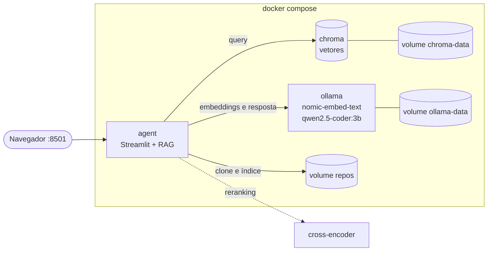

# Agente RAG local para repositórios de código

Pergunte em português sobre o código de qualquer repositório e receba respostas com arquivo e linha. Tudo roda na sua máquina com Docker: LLM e embeddings no Ollama, vetores no ChromaDB, reranking e interface web. **Sem chaves de API e sem passos manuais.**

## Rodar (3 comandos)

```bash
git clone https://github.com/edermendes2016/langchain-local-agent.git
cd langchain-local-agent
docker compose up --build
```

Quando o log mostrar **"Pronto! Abra http://localhost:8501"**, abra o endereço e pergunte. Na primeira vez o Docker constrói as imagens, o Ollama baixa os modelos sozinho (`qwen2.5-coder:3b` e `nomic-embed-text`, cerca de 2 GB) e o agente indexa o núcleo do LangChain (`libs/core`), o que leva uns 10 minutos em CPU. O tempo total da primeira execução depende principalmente da velocidade da internet (imagens e modelos somam vários GB). Nas próximas vezes sobe em segundos, porque modelos e índice ficam em volumes.

**Requisitos:** Docker Desktop com Compose v2, 8 GB de RAM liberados para o Docker, cerca de 15 GB de disco livre e internet apenas na primeira execução. GPU é opcional.

## Arquitetura



Pergunta → busca no Chroma (`collection.query()`) → reranking com cross-encoder → trechos com arquivo e linha → LLM local → resposta citando as fontes.

## Usar sem a interface

```bash
docker compose exec agent python agent_local.py ask "Onde fica a classe BaseChatModel?" -r langchain
```

## Configurar

Copie `.env.example` para `.env` para trocar modelos (`LLM_MODEL`, `EMBEDDING_MODEL`), o reranker (`cross-encoder`, `bm25` ou `none`) ou a porta. Para analisar outro repositório, adicione um bloco em [`docker/repos.docker.yaml`](docker/repos.docker.yaml) e liste o nome em `BOOTSTRAP_REPOS`. Com GPU NVIDIA: `docker compose -f docker-compose.yml -f docker-compose.gpu.yml up`.

Para parar: `docker compose down` (mantém os dados) ou `docker compose down -v` (apaga tudo).

## Sem Docker

Também roda direto no Windows com o LM Studio como LLM. O passo a passo, as decisões técnicas (chunking por linguagem, reranking, avaliação com perguntas de referência) e os resultados estão na **[wiki](https://github.com/edermendes2016/langchain-local-agent/wiki)**, versionada em [`docs/wiki`](docs/wiki).
