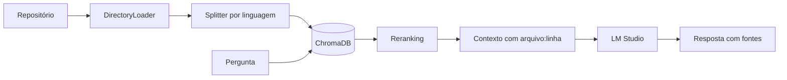

# Agente RAG local para repositórios de código

Faça perguntas em português sobre qualquer repositório e receba respostas com arquivo e linha, rodando 100% local: embeddings `sentence-transformers`, banco vetorial ChromaDB e LLM no LM Studio (`prism-ml/bonsai-27b`).



## Início rápido

```powershell
py -3.12 -m venv .venv; .\.venv\Scripts\Activate.ps1
pip install -r requirements.txt
python agent_local.py clone -r langchain
python agent_local.py index -r langchain
python agent_local.py ask "Onde fica a classe BaseChatModel?" -r langchain
streamlit run app.py
```

O LM Studio precisa estar com o modelo carregado e o servidor ligado em `http://localhost:1234/v1`.

## Documentação

O passo a passo completo, as decisões técnicas e a avaliação estão na **[wiki do projeto](https://github.com/edermendes2016/langchain-local-agent/wiki)**. Os mesmos textos ficam versionados em [`docs/wiki`](docs/wiki).

Para analisar outro repositório, basta um bloco novo no [`repos.yaml`](repos.yaml).
