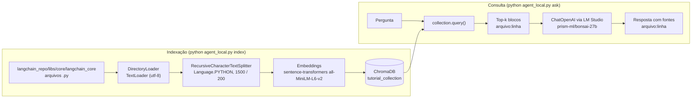

# Agente RAG local para o código do LangChain

Agente que responde perguntas sobre o código-fonte do LangChain de forma 100% local, citando arquivo e linha de cada trecho usado, sem enviar código para a nuvem.

## Arquitetura



## Por que ChromaDB explícito

O cliente, a função de embedding e a coleção são criados explicitamente, sem camadas de abstração do LangChain para o armazenamento vetorial:

```python
chroma_client = chromadb.PersistentClient(path=CHROMA_PATH)
embedding_fn = SentenceTransformerEmbeddingFunction(model_name=EMBEDDING_MODEL)
collection = chroma_client.get_or_create_collection(
    name=COLLECTION_NAME,
    embedding_function=embedding_fn,
    metadata={"hnsw:space": "cosine"},
)
```

A inserção é feita em lotes, com metadados de arquivo e linha inicial de cada bloco:

```python
collection.add(
    documents=documents[b:b + batch_size],
    metadatas=metadatas[b:b + batch_size],
    ids=ids[b:b + batch_size],
)
```

A busca retorna os blocos mais próximos da pergunta, com distância cosseno:

```python
results = collection.query(query_texts=[question], n_results=k)
```

Assim o caminho do dado fica visível no código: o que entra, como é indexado e o que é recuperado para o contexto.

## Model Routing

A construção do projeto e a execução usam papéis de modelo diferentes:

| Papel | Modelo | Motivo |
|---|---|---|
| Arquitetura, dependências e código complexo (tempo de construção) | Modelo de fronteira grande (nuvem) | Maior capacidade de raciocínio para decisões de design. Uso pontual. |
| Cérebro de consulta do RAG (tempo de execução) | prism-ml/bonsai-27b via LM Studio | Privacidade (o código não sai da máquina) e custo zero por consulta. |
| Embeddings (indexação e busca) | all-MiniLM-L6-v2 via sentence-transformers | Roda localmente, leve e sem custo por uso. |
| Documentação e README | Modelo leve e rápido | Custo e velocidade adequados para texto de apoio. |

## Pré-requisitos

- Python 3.12
- Git
- LM Studio com o modelo `prism-ml/bonsai-27b` carregado e o servidor local ativo na porta 1234

## Instalação (Windows PowerShell)

Execute na pasta do projeto:

```powershell
git clone --depth 1 https://github.com/langchain-ai/langchain.git langchain_repo
py -3.12 -m venv .venv
.\.venv\Scripts\Activate.ps1
pip install -r requirements.txt
```

## Uso

Indexar o escopo padrão (`libs/core/langchain_core`):

```powershell
python agent_local.py index
```

Reindexar um escopo maior, apagando a coleção anterior:

```powershell
python agent_local.py index --scope libs --reset
```

Fazer uma pergunta:

```powershell
python agent_local.py ask "Onde fica a classe base dos modelos de chat?"
```

Aumentar a quantidade de blocos recuperados (padrão: 6):

```powershell
python agent_local.py ask -k 8
```

Sem pergunta, `ask` executa a pergunta arquitetural de demonstração (BaseChatModel e o caminho do método `invoke`).

A saída lista os blocos recuperados como `caminho:linha` com a similaridade, e depois a resposta do modelo, que cita essas referências.

## Variáveis de ambiente

Todas são opcionais. Os valores abaixo são os padrões.

| Variável | Padrão | Descrição |
|---|---|---|
| `REPO_PATH` | `./langchain_repo` | Pasta do repositório clonado |
| `CHROMA_PATH` | `./chroma_db` | Pasta de persistência do ChromaDB |
| `EMBEDDING_MODEL` | `all-MiniLM-L6-v2` | Modelo de embeddings do sentence-transformers |
| `LLM_BASE_URL` | `http://localhost:1234/v1` | Endpoint compatível com OpenAI do LM Studio |
| `LLM_MODEL` | `prism-ml/bonsai-27b` | Modelo carregado no LM Studio |

## Estrutura de pastas

```
portfolio-langchain-local-agent/
├── agent_local.py       # indexação, consulta RAG e CLI
├── requirements.txt     # dependências do projeto
├── README.md
├── langchain_repo/      # clone do repositório (gerado, não versionado)
└── chroma_db/           # índice vetorial persistente (gerado)
```

## Resultado da validação

Execução em 11/11/2026, Windows 11, CPU para embeddings e LM Studio com `prism-ml/bonsai-27b`.

**Indexação** (`python agent_local.py index`): 187 arquivos `.py` de `libs/core/langchain_core` viraram 2.347 blocos, gravados na `tutorial_collection` em 32,5 s.

**Consulta 1** (`python agent_local.py ask`, k=6): a fonte mais relevante foi `language_models/chat_models.py:325` (similaridade 0,638), exatamente onde `BaseChatModel` é declarada. O modelo localizou a classe corretamente e, como o trecho de `invoke` não estava entre os 6 blocos, disse explicitamente que não podia descrever esse fluxo em vez de inventar.

**Consulta 2** (`ask "Como o método invoke do BaseChatModel chama generate_prompt..." -k 10`): o bloco `chat_models.py:515` com o `invoke` foi recuperado e o modelo explicou a cadeia `invoke` → `generate_prompt` → `generations[0][0].message`, citando arquivo e linha, e apontou quais partes do fluxo faltavam no contexto. Tempo de resposta: 81 s.

As saídas completas estão em `validacao_demo.txt` e `validacao_invoke.txt`.

**Aprendizado:** o modelo local respeita o contexto e não alucina; o gargalo de qualidade está na recuperação (top-k e granularidade dos blocos), o que aponta para reranking e busca híbrida como próximos passos.

## Próximos passos

- Indexar o monorepo inteiro (todos os pacotes de `libs/`), avaliando o custo de indexação e de memória.
- Adicionar reranking dos blocos recuperados para melhorar a precisão do top-k.
- Criar uma interface em Streamlit para navegar pelas perguntas, fontes e trechos.
- Avaliar o agente com um conjunto de perguntas de referência, com respostas esperadas e arquivos corretos.
