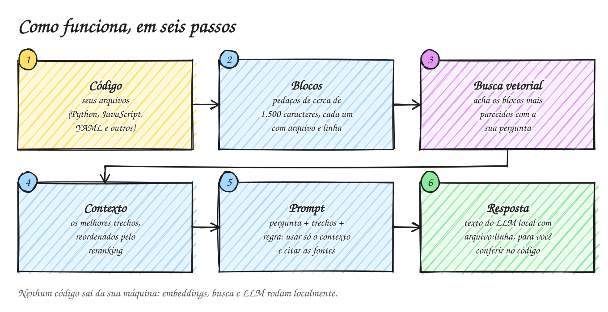

# Agente RAG local para repositórios de código

Pergunte em português sobre qualquer repositório de código e receba respostas ancoradas em trechos reais, com arquivo e linha. Tudo roda na sua máquina: embeddings locais, banco vetorial ChromaDB e um LLM local no LM Studio. Nenhum código sai do computador.

Dois repositórios já vêm configurados como exemplo: o núcleo do **LangChain** (`libs/core/langchain_core`) e o **aws-sandbox-quiz-da-nuvem** (Python, JavaScript, HTML, YAML e shell misturados).

## Passo a passo

0. [Rodar tudo com Docker](Docker): o caminho mais rápido, um comando e sem chaves
1. [LM Studio](LM-Studio): subir o modelo local e o servidor
2. [Ambiente Python](Ambiente-Python): instalar dependências
3. [Indexação](Indexacao): gravar o código no ChromaDB
4. [Consulta RAG](Consulta-RAG): enviar o prompt e receber a resposta
5. [Interface Streamlit](Interface-Streamlit): navegar por perguntas, fontes e trechos
6. [Outro repositório](Outro-repositorio): apontar o agente para qualquer projeto

## Decisões técnicas

- [Para que serve e uso em empresas](Uso-em-empresas)
- [Dojo: treinar o olhar crítico com IA](Dojo)
- [Boas práticas de RAG aplicadas](Boas-praticas-RAG)
- [Reranking](Reranking)
- [Avaliação com perguntas de referência](Avaliacao)
- [Problemas comuns](Problemas-comuns)

## Como funciona

<picture>
  <source media="(prefers-color-scheme: dark)" srcset="images/fluxo-simples-dark.svg">
  
</picture>

A visão completa, com os serviços do Docker, está em [Rodar tudo com Docker](Docker).
